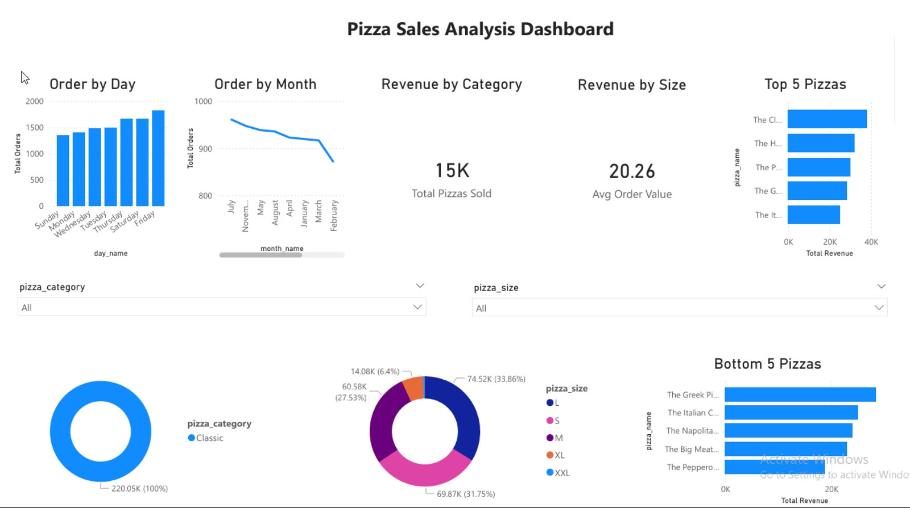

# Pizza Sales Analysis

An end-to-end data analytics project on a pizza restaurant's sales data for 2015. The raw data was cleaned in Python, stored and queried in PostgreSQL, summarized with Excel pivot tables, and presented in an interactive Power BI dashboard.

## Tools

- Python (Pandas) for data cleaning
- PostgreSQL (pgAdmin 4) for storing and querying data
- Microsoft Excel for pivot tables
- Power BI Desktop for the dashboard

## Dataset

- Pizza sales data from Kaggle: 48,620 rows and 12 columns
- Order dates from 1 January 2015 to 31 December 2015
- Columns include order id, pizza name, category, size, quantity, unit price, total price, order date, and order time
- The data has no cost or profit column, so the analysis focuses on revenue, orders, and quantity sold

## Workflow

1. **Cleaning (Python):** removed duplicate rows (none found), fixed the date column, which mixed two formats (`13-01-2015` and `1/1/2015`, both day first), converted ids and quantity to integers, and added month, day, and hour columns. See `pizza_clean.ipynb`.
2. **Database (PostgreSQL):** created a `pizza_sales` table and loaded the cleaned data. Queries are in `queries.sql` and their outputs are in `sql_results/`.
3. **Excel:** built pivot tables for revenue by category, size, and month, and the top 10 pizzas. See `pizza_analysis.xlsx`.
4. **Dashboard (Power BI):** built KPI cards, charts for daily and monthly orders, revenue share by category and size, top 5 and bottom 5 pizzas, and slicers. See `pizza_dashboard.pbix`.

## Key metrics

| Metric | Value |
|---|---|
| Total revenue | 817,860.05 |
| Total orders | 21,350 |
| Total pizzas sold | 49,574 |
| Average order value | 38.31 |
| Average pizzas per order | 2.32 |

## Insights

- **Friday is the busiest day** (3,538 orders) and **Sunday is the slowest** (2,624).
- **July has the most orders** (1,935). October has the fewest (1,646).
- **Lunch and early evening are the peak hours:** 12 pm (2,520 orders), 1 pm (2,455), 6 pm (2,399), and 5 pm (2,336).
- **Classic is the top category** by revenue (26.9%), followed by Supreme (25.5%), Chicken (24.0%), and Veggie (23.7%).
- **Large pizzas bring in the most revenue** (45.9%). XL and XXL together are under 2%.
- **Top 5 pizzas by revenue:** The Thai Chicken Pizza (43.4K), The Barbecue Chicken Pizza (42.8K), The California Chicken Pizza (41.4K), The Classic Deluxe Pizza (38.2K), and The Spicy Italian Pizza (34.8K).
- **Bottom 5 pizzas by revenue:** The Brie Carre Pizza (11.6K), The Green Garden Pizza (14.0K), The Spinach Supreme Pizza (15.3K), The Mediterranean Pizza (15.4K), and The Spinach Pesto Pizza (15.6K).

## Files

- `pizza_clean.ipynb`: data cleaning and loading notebook
- `queries.sql`: PostgreSQL table and analysis queries
- `sql_results/`: CSV outputs of the SQL queries
- `pizza_analysis.xlsx`: Excel pivot tables
- `pizza_dashboard.pbix`: Power BI dashboard
- `pizza_dashboard.pdf`: dashboard export
- `dashboard.png`: dashboard screenshot
